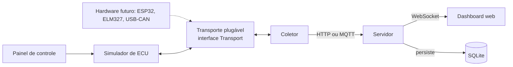

# 2. Arquitetura, stack e estrutura do repositório

## Arquitetura

O coletor só conhece a interface `Transport`. Trocar o simulador por um adaptador ELM327 ou por um ESP32 muda a classe de transporte e mais nada.



**Fluxo de dados**

1. O painel de controle altera o simulador por HTTP.
2. O coletor pede PIDs ao transporte e a ECU virtual responde.
3. O coletor publica um `Sample` por HTTP, WebSocket ou MQTT.
4. O servidor grava no SQLite e repassa por WebSocket.
5. O dashboard desenha os valores e o estado dos DTCs.

## Stack

| Camada | Escolha | Motivo |
| --- | --- | --- |
| Linguagem | Python 3.12+ | Reaproveita o ambiente do TCC e o `python-can` |
| Servidor | FastAPI + Uvicorn | HTTP, WebSocket e OpenAPI automático |
| Assíncrono | `asyncio` | Coletor, simulador e servidor no mesmo processo ou separados |
| CAN virtual | `python-can` (interface `virtual`) | Barramento CAN em memória, trocável por `socketcan` ou `slcan` |
| Banco | SQLite via SQLAlchemy 2 | Zero configuração, fácil de reproduzir |
| Mensageria (opcional) | MQTT com Mosquitto | Mantém a trilha do TCC; ativada por configuração |
| Front-end | HTML + JavaScript puro, SVG para os manômetros | Funciona offline e sem build |
| Testes | pytest, pytest-asyncio, hypothesis | Unitário, propriedade e integração |
| Qualidade | ruff, mypy, pre-commit | Padronização |
| Execução | Docker Compose e Makefile | RNF07 |

## Estrutura de diretórios

```text
.
  pyproject.toml
  Makefile
  docker-compose.yml
  config/
    default.yaml            # transporte, PIDs, taxas, portas
    profiles/               # ciclos de condução e cenários de falha (YAML)
  src/obd/
    protocol/               # núcleo puro, sem I/O
      pids.py               # tabela de PIDs, fórmulas de encode/decode
      dtc.py                # codificação e descrição de DTCs
      frames.py             # montagem e validação de quadros CAN 11 bits
      isotp.py              # transporte ISO-TP (SF, FF, CF, FC)
      services.py           # modos 01, 02, 03, 04, 07, 09
    transport/              # como os bytes chegam à ECU
      base.py               # interface Transport
      can_virtual.py        # python-can virtual
      elm327_tcp.py         # cliente ELM327 por socket
      serial_port.py        # reservado para ESP32 ou ELM327 serial
      loopback.py           # para testes
    simulator/
      vehicle_model.py      # física simplificada e ciclo de condução
      ecu.py                # ECU virtual (responde ISO 15765-4)
      faults.py             # injeção de falhas e atrasos
      elm327_server.py      # servidor TCP compatível com ELM327
      control_api.py        # rotas do painel de controle
    collector/
      collector.py          # laço de aquisição por PID e DTC
      scheduler.py          # prioridade e taxa por PID
      publisher.py          # envia ao servidor (HTTP, WS ou MQTT)
    server/
      app.py                # FastAPI
      routes.py             # REST
      ws.py                 # WebSocket e SSE
      storage.py            # SQLAlchemy
      models.py             # tabelas e schemas Pydantic
    web/
      dashboard/            # index.html, app.js, gauges.js
      simulator_panel/      # painel de controle
  tests/
    unit/  integration/  e2e/  benchmarks/
  docs/
    spec.md  PLAN.md  ensaios.md
  tasks/
```
