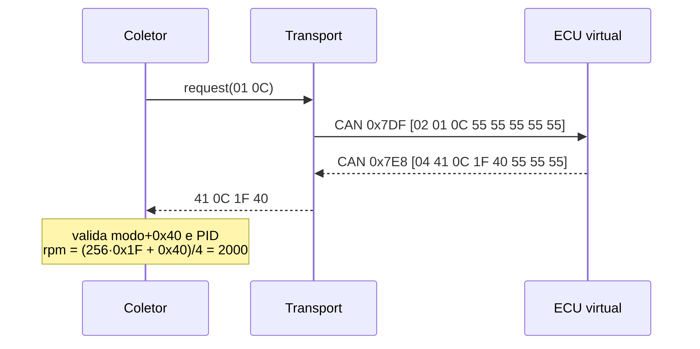
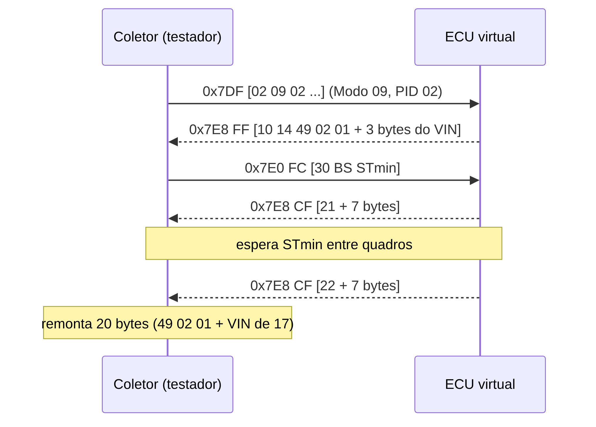

# FUNDAMENTAÇÃO TÉCNICA

Este capítulo apresenta os conceitos e as tecnologias necessários para entender a plataforma. Ele segue a ordem em que uma requisição percorre o sistema: do protocolo de diagnóstico (OBD-II) à rede (CAN), depois à camada de transporte (ISO-TP), ao adaptador (ELM327) e, por fim, às tecnologias de software que armazenam, distribuem e mostram os dados. A justificativa de cada escolha entre alternativas fica para o Capítulo 4.

## DIAGNÓSTICO DE BORDO OBD-II

O OBD-II é definido por um conjunto de documentos que se complementam. A SAE J1962 especifica o conector de diagnóstico de 16 pinos e sua pinagem (SAE INTERNATIONAL, 2016a). A SAE J1979 define os modos de serviço de diagnóstico e os identificadores de parâmetros, com suas fórmulas de conversão (SAE INTERNATIONAL, 2017). A SAE J2012 define a estrutura e o significado dos códigos de falha (SAE INTERNATIONAL, 2016b). A ISO 15765-4 especifica como esses serviços trafegam sobre CAN em veículos com sistemas relacionados a emissões (INTERNATIONAL ORGANIZATION FOR STANDARDIZATION, 2021).

### Modos de serviço

A comunicação é do tipo requisição e resposta. Uma ferramenta (o testador) envia uma requisição cujo primeiro byte é o **modo** de serviço. A ECU responde com o mesmo modo somado de `0x40`, de modo que a resposta ao modo `0x01` começa com `0x41`. Quando a requisição é inválida, a resposta negativa começa com `0x7F`, seguida do modo e de um código de motivo. A Tabela 2 resume os modos implementados neste trabalho.

::: {custom-style="LegendaTabela"}
Tabela 2: Modos de serviço OBD-II implementados
:::

| Modo | Requisição | Resposta | Finalidade |
| --- | --- | --- | --- |
| 01 | `01 PID` | `41 PID dados` | Dados atuais do motor |
| 02 | `02 PID 00` | `42 PID 00 dados` | Dados congelados no instante de uma falha |
| 03 | `03` | `43 N` e N códigos de 2 bytes | Códigos de falha armazenados |
| 04 | `04` | `44` | Limpa códigos e dados congelados |
| 07 | `07` | `47 N` e N códigos | Códigos de falha pendentes |
| 09 | `09 02` | `49 02 01` e 17 bytes | Número de identificação do veículo (VIN) |

::: {custom-style="Fonte"}
Fonte: docs/spec/04-protocolo.md, a partir de SAE International (2017).
:::

### Identificadores de parâmetros (PIDs)

No modo 01, o segundo byte da requisição é o PID, que escolhe a grandeza. A resposta traz o PID repetido, seguido de 1 a 4 bytes de dados que o testador converte em valor físico por uma fórmula do padrão. A Tabela 3 lista os PIDs implementados, com a fórmula e a resolução, isto é, o menor passo que o byte transmitido consegue representar.

::: {custom-style="LegendaTabela"}
Tabela 3: PIDs implementados, fórmulas e resoluções
:::

| PID | Grandeza | Bytes | Fórmula | Unidade | Resolução |
| --- | --- | --- | --- | --- | --- |
| 0x04 | Carga calculada | 1 | A·100/255 | % | 0,392 |
| 0x05 | Temperatura do arrefecimento | 1 | A − 40 | °C | 1 |
| 0x06 | Ajuste de combustível de curto prazo | 1 | (A − 128)·100/128 | % | 0,781 |
| 0x0B | Pressão do coletor (MAP) | 1 | A | kPa | 1 |
| 0x0C | Rotação do motor | 2 | (256A + B)/4 | rpm | 0,25 |
| 0x0D | Velocidade | 1 | A | km/h | 1 |
| 0x0F | Temperatura do ar de admissão | 1 | A − 40 | °C | 1 |
| 0x11 | Posição da borboleta | 1 | A·100/255 | % | 0,392 |
| 0x2F | Nível de combustível | 1 | A·100/255 | % | 0,392 |
| 0x42 | Tensão do módulo de controle | 2 | (256A + B)/1000 | V | 0,001 |

::: {custom-style="Fonte"}
Fonte: docs/spec/04-protocolo.md, a partir de SAE International (2017).
:::

Os PIDs `0x00`, `0x20` e `0x40` têm função especial: devolvem uma máscara de 32 bits que informa quais PIDs de cada faixa de 32 a ECU suporta, com o bit mais significativo correspondendo ao primeiro PID da faixa. O último bit da máscara indica se há suporte a algum PID da faixa seguinte. É assim que uma ferramenta descobre o que pode perguntar, em vez de tentar às cegas. O PID `0x01` informa o estado do monitor de diagnóstico: o bit 7 do primeiro byte indica se a MIL está acesa e os bits 0 a 6 contam os códigos de falha armazenados.

Como a resposta carrega um número inteiro de 8 ou 16 bits, a conversão perde informação: um valor físico qualquer é arredondado para o passo mais próximo. O erro máximo de decodificação é, portanto, a metade da resolução, e esse limite teórico é o critério usado neste trabalho para dizer se uma leitura está correta (Seção 4.1, requisito RF06).

### Códigos de falha (DTC)

Um código de falha ocupa 2 bytes. Os dois bits mais altos do primeiro byte escolhem o sistema (`00` para *Powertrain*, letra P; `01` para *Chassis*, C; `10` para *Body*, B; `11` para *Network*, U), os dois bits seguintes dão o primeiro dígito (0 a 3) e os 12 bits restantes formam três dígitos hexadecimais. Assim, os bytes `03 00` representam o código P0300, "falha de ignição aleatória ou em múltiplos cilindros" (SAE INTERNATIONAL, 2016b). Quando um código é armazenado, a ECU também captura os valores dos PIDs naquele instante, os chamados dados congelados (*freeze frame*), acessíveis pelo modo 02.

## REDE CAN

O CAN transmite mensagens em quadros. No formato base, o quadro tem um identificador de 11 bits, um campo de controle com o comprimento dos dados (DLC, de 0 a 8), até 8 bytes de dados, um CRC e campos de confirmação e delimitação (BOSCH, 1991; INTERNATIONAL ORGANIZATION FOR STANDARDIZATION, 2015). O identificador não nomeia um destinatário: ele nomeia o **conteúdo** da mensagem e define a prioridade. Quando dois nós tentam transmitir ao mesmo tempo, vence aquele cujo identificador tem o menor valor numérico, sem perda do quadro vencedor.

No OBD-II sobre CAN de 11 bits e 500 kbit/s, os identificadores têm papéis fixos (INTERNATIONAL ORGANIZATION FOR STANDARDIZATION, 2021):

- `0x7DF`: requisição funcional, endereçada a todas as ECUs ao mesmo tempo;
- `0x7E0` a `0x7E7`: requisições físicas, endereçadas a uma ECU específica;
- `0x7E8` a `0x7EF`: respostas, em que `0x7E8` é, por convenção, a ECU do motor.

Os quadros do OBD-II têm sempre 8 bytes, com preenchimento de `0x55` nos bytes não usados. Em 500 kbit/s, cada bit dura 2 µs. O comprimento de um quadro de dados com 8 bytes no pior caso (com inserção de bits de preenchimento) é de 135 bits, ou 270 µs, valor obtido pela expressão da literatura para o comprimento máximo de um quadro, C = 47 + 8s + ⌊(34 + 8s − 1)/4⌋ bits, com s = 8 (DAVIS et al., 2007). Esse é o tempo que o barramento físico gastaria por quadro; o barramento virtual deste trabalho não o reproduz.

A norma ainda impõe um prazo ao testador. O tempo máximo de resposta da ECU à requisição, chamado P2, é de 50 ms. Respostas além desse prazo são tratadas como ausência de resposta.

A Figura 1 mostra uma consulta completa de rotação. O testador envia o quadro `02 01 0C` (2 bytes úteis, modo 01, PID 0C) ao identificador `0x7DF`. A ECU responde em `0x7E8` com `04 41 0C 1F 40` (4 bytes úteis, modo 41, PID 0C, dados `1F 40`). A rotação é (256 · 31 + 64)/4 = 2000 rpm.

{width=11cm}

::: {custom-style="LegendaFigura"}
Figura 1: Consulta de rotação (modo 01, PID 0C) sobre CAN
:::

::: {custom-style="Fonte"}
Fonte: elaborada pelos autores (diagrama gerado de docs/tcc/img/fig-seq.mmd).
:::

## TRANSPORTE ISO-TP

Um quadro CAN carrega no máximo 8 bytes, e algumas respostas OBD são maiores. O VIN, por exemplo, tem 17 caracteres. A camada de transporte ISO-TP, definida na ISO 15765-2 (INTERNATIONAL ORGANIZATION FOR STANDARDIZATION, 2016b), resolve isso segmentando uma mensagem em vários quadros e remontando-a no destino. O primeiro byte do campo de dados de cada quadro é a informação de controle de protocolo (PCI), e seu primeiro nibble define o tipo do quadro, conforme a Tabela 4.

::: {custom-style="LegendaTabela"}
Tabela 4: Tipos de quadro do ISO-TP
:::

| Tipo | Byte PCI | Conteúdo |
| --- | --- | --- |
| Quadro único (SF) | `0x0N` | N bytes úteis (1 a 7) |
| Primeiro quadro (FF) | `0x1L LL` | Comprimento total em 12 bits e 6 bytes de dados |
| Quadro consecutivo (CF) | `0x2S` | Número de sequência S (0 a F) e 7 bytes de dados |
| Controle de fluxo (FC) | `0x30 BS STmin` | Autoriza o envio: tamanho do bloco e espaçamento mínimo |

::: {custom-style="Fonte"}
Fonte: docs/spec/04-protocolo.md, a partir da ISO 15765-2.
:::

Mensagens de até 7 bytes cabem em um quadro único. Mensagens maiores começam com um primeiro quadro, que informa o comprimento total. Quem recebe responde com um quadro de controle de fluxo, em que **BS** (*block size*) diz quantos quadros consecutivos podem vir antes do próximo controle de fluxo (0 significa "sem limite") e **STmin** diz o tempo mínimo entre quadros consecutivos. A remontagem tem um prazo: se um quadro consecutivo não chegar em 1 s (parâmetro N_Cr), a recepção é abortada.

A Figura 2 mostra a leitura do VIN (modo 09, PID 02). A resposta tem 20 bytes: `49 02 01` seguidos dos 17 caracteres. O primeiro quadro carrega 6 bytes (os 3 do cabeçalho e 3 caracteres do VIN) e dois quadros consecutivos carregam 7 bytes cada, totalizando 6 + 7 + 7 = 20 bytes.

{width=12cm}

::: {custom-style="LegendaFigura"}
Figura 2: Leitura do VIN por ISO-TP (primeiro quadro, controle de fluxo e dois quadros consecutivos)
:::

::: {custom-style="Fonte"}
Fonte: elaborada pelos autores (diagrama gerado de docs/tcc/img/fig-isotp.mmd).
:::

## ADAPTADOR ELM327

O ELM327 é um circuito integrado da Elm Electronics que faz a ponte entre uma interface serial e os protocolos OBD-II (ELM ELECTRONICS, [s.d.]). O computador ou o aplicativo não monta quadros CAN: envia linhas de texto, e o chip faz o resto. Há duas famílias de comandos. Os comandos **AT** configuram o adaptador (`ATZ` reinicia, `ATE0` desliga o eco, `ATSP0` escolhe o protocolo automático, `ATH1` liga a exibição de cabeçalhos, `ATDPN` informa o protocolo em uso). Qualquer linha que não comece com AT é enviada ao veículo como requisição OBD em hexadecimal, por exemplo `010C`. O chip responde com os bytes da resposta em hexadecimal e termina com o caractere de prompt `>`.

Adaptadores Wi-Fi baseados nesse chip costumam criar uma rede própria e aceitar conexões TCP em um endereço e porta típicos (192.168.0.10 e 35000). Esse arranjo é importante porque transforma o adaptador em um servidor de texto simples sobre TCP, que qualquer cliente em qualquer sistema consegue usar. Bibliotecas como a python-OBD (PYTHON-OBD, [s.d.]) e aplicativos de celular e de computador se apoiam nesse dialeto. Ao fazer o simulador falar o mesmo dialeto, ganha-se acesso a todo esse ecossistema como clientes de teste.

Na prática, o dialeto tem sutilezas que não estão no padrão OBD-II: o formato das linhas com cabeçalho ligado (`7E8 06 41 00 9C 3A 80 01`, com identificador, byte de comprimento do ISO-TP e dados), as respostas `NO DATA` e `SEARCHING...`, a lista de comandos AT que um cliente espera ver aceitos. Essas sutilezas foram descobertas, no desenvolvimento deste trabalho, justamente ao testar o simulador contra clientes de terceiros (Seção 5.7).

## TECNOLOGIAS DE SOFTWARE

### Python e programação assíncrona

Python 3.12 ou superior é a linguagem de toda a plataforma. A biblioteca padrão `asyncio` permite executar muitas tarefas que passam a maior parte do tempo esperando entrada e saída (rede, temporizadores) em um único fio de execução, com a sintaxe `async` e `await`. O coletor, o simulador e o servidor são, em boa parte, esse tipo de tarefa.

### python-can

A biblioteca `python-can` oferece uma abstração de barramento CAN com várias interfaces de *hardware* e uma interface `virtual`, que simula um barramento em memória entre objetos do mesmo processo (PYTHON-CAN, [s.d.]). Trocar a interface virtual por `socketcan` ou `slcan` muda a configuração, não o código.

### FastAPI, Uvicorn e Pydantic

O FastAPI é um arcabouço para construir APIs em Python com tipagem e validação de dados a partir de anotações de tipo (FASTAPI, [s.d.]). Ele gera documentação OpenAPI automaticamente e suporta WebSocket. O Uvicorn é o servidor ASGI que o executa, e o Pydantic valida os esquemas JSON das mensagens.

### HTTP, WebSocket e MQTT

O HTTP é o protocolo de requisição e resposta da web (FIELDING; NOTTINGHAM; RESCHKE, 2022). O WebSocket abre um canal bidirecional e persistente sobre uma conexão HTTP, adequado a fluxos em tempo real (FETTE; MELNIKOV, 2011). O MQTT é um protocolo de publicação e assinatura com um intermediário, em que os assuntos são tópicos hierárquicos como `telemetria/<veiculo>/dados`, e em que cada publicação escolhe um nível de QoS (OASIS, 2014). O QoS 0 entrega no máximo uma vez, sem confirmação; o QoS 1 entrega ao menos uma vez, com confirmação.

### SQLite e SQLAlchemy

O SQLite é um banco de dados relacional embutido, que guarda tudo em um único arquivo e dispensa um processo servidor (SQLITE, [s.d.]). O SQLAlchemy 2 é o mapeador objeto-relacional, usado aqui em modo assíncrono.

### Front-end com HTML, JavaScript e SVG

O dashboard e o painel de controle são páginas HTML com JavaScript puro, sem estrutura de construção e sem bibliotecas externas. Os mostradores (conta-giros e manômetro) são desenhados em SVG, formato vetorial que o navegador renderiza e que pode ser animado por script.

### Docker e Docker Compose

O Docker empacota uma aplicação e suas dependências em uma imagem, executada como contêiner isolado do sistema anfitrião. O Docker Compose descreve, em um arquivo, vários contêineres e como se conectam (DOCKER, [s.d.]). Aqui ele serve a dois propósitos: executar a plataforma com um comando e isolar as ferramentas de desenvolvimento, de modo que nada precise ser instalado no computador do autor além do próprio Docker.

### Testes: pytest e hypothesis

O `pytest` é o executor de testes usado em todos os níveis. O `hypothesis` implementa testes baseados em propriedades: em vez de exemplos fixos, o desenvolvedor descreve uma propriedade que deve valer para qualquer entrada (por exemplo, "decodificar o que foi codificado devolve o valor original dentro da resolução") e a biblioteca gera muitos casos, inclusive os de borda.

## SÍNTESE

O percurso de uma leitura é o seguinte: um aplicativo ou o coletor escolhe um modo e um PID; a requisição vira um quadro CAN de 8 bytes em `0x7DF`; a ECU responde em `0x7E8`, usando ISO-TP quando a resposta é maior que 7 bytes; o testador converte os bytes em valor físico pela fórmula do PID; o valor é publicado, armazenado e exibido. Um adaptador ELM327 esconde os quadros e expõe esse mesmo percurso como texto por TCP. As próximas seções mostram como cada etapa foi construída.
