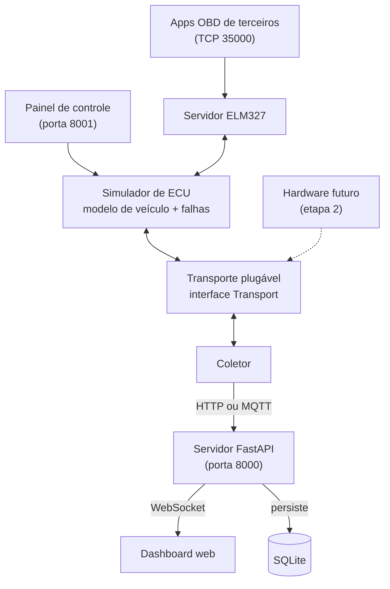
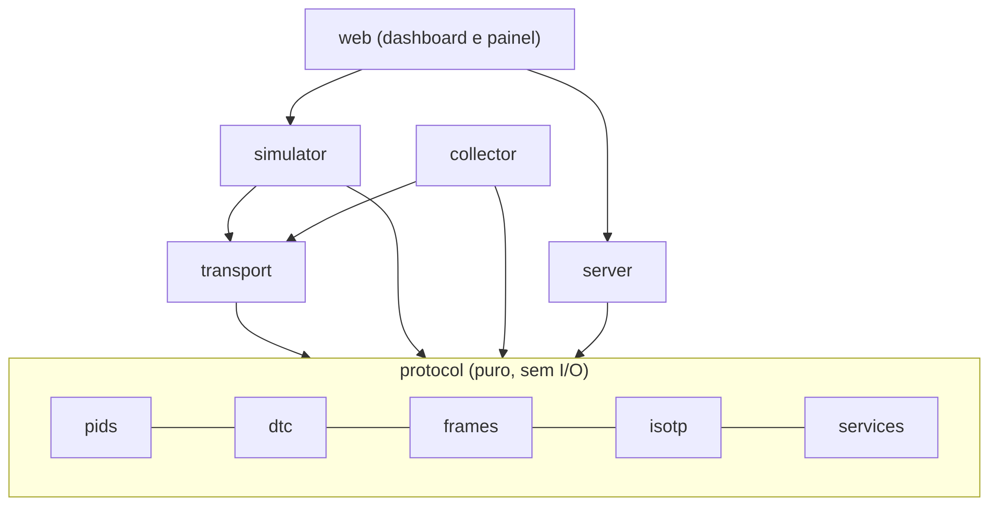
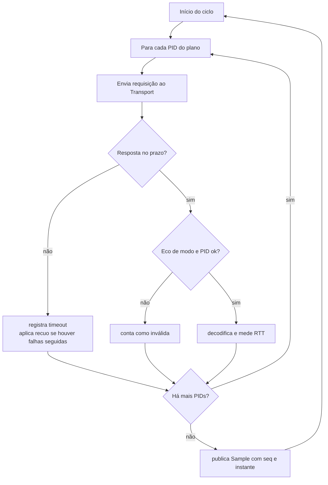
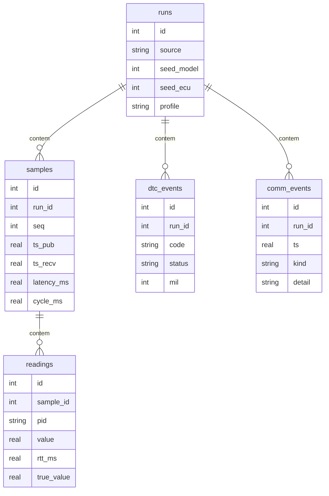
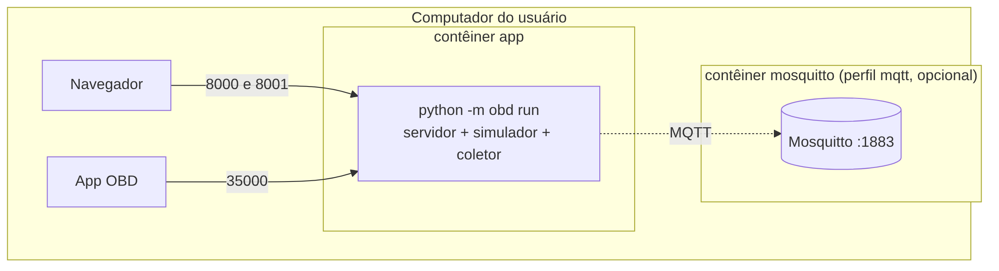

# MATERIAIS E MÉTODOS

Este capítulo descreve o que foi construído e como. Ele começa pelos requisitos e pela arquitetura, justifica as escolhas de tecnologia frente às alternativas, detalha cada módulo (protocolo, simulador, transporte, coletor, servidor e interfaces) e termina com a estratégia de testes, o ambiente de execução, o processo de desenvolvimento e o desenho dos ensaios.

## REQUISITOS

Os requisitos foram escritos antes do código e cada um tem um critério de aceitação verificável. A Tabela 5 reúne os requisitos funcionais e a Tabela 6 os não funcionais.

::: {custom-style="LegendaTabela"}
Tabela 5: Requisitos funcionais (RF) e critérios de aceitação
:::

| ID | Requisito | Critério de aceitação |
| --- | --- | --- |
| RF01 | O simulador responde ao modo 01 para os PIDs configurados | Resposta em 0x7E8 com modo + 0x40 e PID repetido |
| RF02 | Descoberta de PIDs suportados (0x00, 0x20, 0x40) | Máscara de 32 bits correta; o coletor pede só PIDs suportados |
| RF03 | Leitura de DTCs (modo 03), pendentes (modo 07) e limpeza (modo 04) | P0300 injetado aparece em até 2 ciclos de consulta; modo 04 zera a lista |
| RF04 | Dados congelados (modo 02) ao surgir uma falha | Freeze frame com os PIDs do instante da falha |
| RF05 | ISO-TP completo (primeiro quadro, consecutivos, controle de fluxo) | VIN de 17 caracteres lido pelo modo 09, PID 0x02 |
| RF06 | O coletor requisita, valida e decodifica PIDs pelas fórmulas da SAE J1979 | Erro máximo ≤ metade da resolução em 100% das leituras |
| RF07 | O servidor recebe a telemetria e a persiste | Nenhuma perda ou duplicação, verificada pelo número de sequência |
| RF08 | API HTTP de consulta e WebSocket de tempo real | O dashboard atualiza sem recarregar |
| RF09 | O painel de controle altera o simulador em tempo de execução | Mudança refletida na leitura em até 2 ciclos |
| RF10 | Camada ELM327 por TCP | Um cliente ELM327 comum completa ATZ, ATE0, 0100 e 010C |
| RF11 | Injeção de falhas de comunicação (atraso, perda, resposta inválida, sem resposta) | O coletor se recupera sem travar e registra o evento |
| RF12 | Transporte plugável por configuração | Trocar o simulador por ELM327/TCP sem alterar o código do coletor |

::: {custom-style="Fonte"}
Fonte: docs/spec/01-visao-requisitos.md.
:::

::: {custom-style="LegendaTabela"}
Tabela 6: Requisitos não funcionais (RNF) e metas
:::

| ID | Requisito | Meta |
| --- | --- | --- |
| RNF01 | Tempo de ciclo de 10 PIDs | ≤ 150 ms com a ECU em 10 ms |
| RNF02 | Latência do coletor ao banco | p95 ≤ 50 ms |
| RNF03 | Perda de mensagens | 0 em ensaio de 240 s |
| RNF04 | Conformidade com a ISO 15765-4 | 11 bits, 500 kbit/s, P2 = 50 ms |
| RNF05 | Reprodutibilidade | Sementes fixas e ensaios repetíveis |
| RNF06 | Cobertura de testes | ≥ 80% nos módulos de protocolo |
| RNF07 | Instalação | Um comando (`docker compose up` ou `make run`) |
| RNF08 | Segurança | Somente leitura; API local, sem exposição externa por padrão |

::: {custom-style="Fonte"}
Fonte: docs/spec/01-visao-requisitos.md.
:::

O RNF05 originalmente pedia repetição em duas máquinas. Como este trabalho mediu apenas uma máquina, a parte de reprodutibilidade que foi cumprida é a determinística (mesmas sementes, mesmos valores físicos e mesmos erros de decodificação), e a comparação de tempos entre máquinas é declarada como pendente (Seção 5.9).

## ARQUITETURA

A arquitetura obedece a uma regra simples: o coletor só conhece a interface `Transport`. O que existe do outro lado dessa interface (um simulador, um barramento CAN virtual, um adaptador ELM327 por TCP ou, na segunda etapa, um microcontrolador) é detalhe de implementação. A Figura 3 mostra os blocos e as conexões.

{width=9.5cm}

::: {custom-style="LegendaFigura"}
Figura 3: Arquitetura da plataforma
:::

::: {custom-style="Fonte"}
Fonte: elaborada pelos autores (docs/tcc/img/fig-arq.mmd).
:::

O fluxo de dados em operação normal tem cinco passos. O painel de controle altera o simulador por HTTP. O coletor pede PIDs ao transporte e a ECU virtual responde. O coletor publica uma amostra (`Sample`) por HTTP ou MQTT. O servidor grava a amostra no SQLite e a repassa por WebSocket. O dashboard desenha os valores e o estado dos códigos de falha.

### Módulos e dependências

O código está organizado em seis módulos sob `src/obd/`, com dependências em um único sentido (Figura 4). O núcleo `protocol` não faz entrada e saída e não depende de nenhum outro módulo. Essa restrição é deliberada: ela permite testar o protocolo sem rede, sem relógio e sem processos, e garante que o que foi validado como "protocolo" não está contaminado por detalhes de infraestrutura.

{width=11cm}

::: {custom-style="LegendaFigura"}
Figura 4: Módulos e sentido das dependências
:::

::: {custom-style="Fonte"}
Fonte: elaborada pelos autores (docs/tcc/img/fig-camadas.mmd).
:::

A Tabela 7 resume a responsabilidade de cada módulo e o tamanho aproximado do código-fonte em linhas.

::: {custom-style="LegendaTabela"}
Tabela 7: Módulos, responsabilidades e tamanho do código-fonte
:::

| Módulo | Responsabilidade | Depende de | Linhas |
| --- | --- | --- | --- |
| `protocol` | Fórmulas, quadros, ISO-TP, serviços, DTCs | nada | 668 |
| `transport` | Enviar e receber quadros OBD | `protocol` | 333 |
| `simulator` | ECU virtual, modelo de veículo, falhas, servidor ELM327, API de controle | `protocol`, `transport` | 1216 |
| `collector` | Requisitar, validar, decodificar e publicar | `protocol`, `transport` | 494 |
| `server` | API, WebSocket, persistência | `protocol` (esquemas) | 793 |
| `web` | Dashboard e painel de controle (HTML, CSS e JavaScript) | API do `server` e do `simulator` | 841 |

::: {custom-style="Fonte"}
Fonte: contagem de linhas dos arquivos `.py`, `.js`, `.html` e `.css` de cada pasta de `src/obd/`, em 24/10/2026. Não inclui `runner.py`, `mqtt_common.py` e testes.
:::

### Portas e processos

Em operação, a plataforma expõe quatro endpoints (Tabela 8). O comando `python -m obd run` sobe servidor, simulador, painel, servidor ELM327 e coletor em um único processo, como tarefas assíncronas; a mesma instância de transporte é compartilhada entre o servidor ELM327 e o coletor, de modo que a semente e as falhas valem para ambos.

::: {custom-style="LegendaTabela"}
Tabela 8: Portas e serviços
:::

| Serviço | Porta | Protocolo | Quem se conecta |
| --- | --- | --- | --- |
| Servidor da plataforma | 8000 | HTTP e WebSocket | Navegador e coletor |
| Simulador (controle) | 8001 | HTTP e WebSocket | Painel de controle |
| Simulador (ELM327) | 35000 | TCP | Aplicativos e bibliotecas OBD de terceiros |
| Mosquitto (opcional) | 1883 | MQTT | Coletor e servidor |

::: {custom-style="Fonte"}
Fonte: docs/spec/05-api.md.
:::

## ESCOLHAS DE TECNOLOGIA

Cada escolha foi feita a partir de um critério explícito: reduzir o atrito para quem quiser executar, entender e estender a plataforma, sem sacrificar o que os requisitos exigem. A Tabela 9 mostra a escolha, as alternativas que seriam plausíveis e o motivo. As alternativas são discutidas por raciocínio de projeto; elas não foram implementadas nem comparadas experimentalmente, com a exceção do canal HTTP contra MQTT, que é medido no ensaio E7.

::: {custom-style="LegendaTabela"}
Tabela 9: Escolhas de tecnologia, alternativas consideradas e motivos
:::

| Camada | Escolha | Alternativas plausíveis | Motivo |
| --- | --- | --- | --- |
| Linguagem | Python 3.12+ | C/C++, Go, Rust, JavaScript | Ecossistema para CAN (`python-can`), web e testes; tipagem completa com `mypy`; permite reaproveitar o ambiente de trabalho já usado pelos autores |
| Concorrência | `asyncio` | Threads, processos, bibliotecas externas | Muitas tarefas que esperam entrada e saída; o coletor, o simulador e o servidor rodam no mesmo processo ou separados |
| Servidor web | FastAPI e Uvicorn | Flask, Django | HTTP, WebSocket e OpenAPI automáticos; validação por tipos |
| CAN virtual | `python-can`, interface `virtual` | SocketCAN `vcan` (só Linux), barramento próprio | Barramento em memória multiplataforma; trocável por `socketcan` ou `slcan` apenas por configuração |
| Banco | SQLite via SQLAlchemy 2 | PostgreSQL, bancos de séries temporais | Zero configuração, arquivo único, simples de reproduzir; volume de dados pequeno |
| Mensageria | HTTP por padrão; MQTT com Mosquitto opcional | Somente MQTT, Kafka, CoAP | HTTP não exige infraestrutura extra; MQTT é o padrão de fato em IoT e é medido contra o HTTP |
| Tempo real no navegador | WebSocket | Consultas periódicas, *Server-Sent Events* | Canal bidirecional e persistente; o servidor empurra amostras sem consulta |
| Front-end | HTML e JavaScript puro, SVG | React, Vue, bibliotecas de gráficos | Funciona sem etapa de construção e sem rede; poucas dependências |
| Testes | pytest, pytest-asyncio, hypothesis | `unittest`, `nose` | Testes simples, assíncronos e baseados em propriedades |
| Qualidade | ruff, mypy (modo estrito), pre-commit | flake8, pylint | Verificação rápida e tipagem completa como porta de entrada |
| Execução | Docker Compose e Makefile | Instalação manual, ambientes virtuais | Um comando (RNF07) e isolamento das ferramentas |

::: {custom-style="Fonte"}
Fonte: docs/spec/02-arquitetura-stack.md, ampliado pelos autores.
:::

### Por que simulador, e não apenas uma gravação de dados reais

Uma alternativa a um simulador é reproduzir dados gravados de um veículo. Ela foi descartada por três razões. Primeiro, dados gravados trazem o que o veículo disse, mas não o valor verdadeiro; o que se mede é a fidelidade da cópia, não a exatidão da decodificação. Segundo, é impossível provocar, em uma gravação, uma falha que não aconteceu. Terceiro, gravações não respondem a requisições: o coletor precisa de uma ECU que reaja ao que ele pergunta, inclusive ao que não deveria perguntar.

### Por que um transporte plugável

O requisito RF12 existe para transformar a validação em software em um ponto de partida para o hardware. Se o coletor dependesse de um simulador específico, a segunda etapa exigiria reescrevê-lo. Com a interface `Transport`, uma nova classe é suficiente. O contrato é pequeno (Seção 4.6) e foi mantido estável durante todo o desenvolvimento.

### Por que o ELM327 como camada de compatibilidade

Há duas formas de aproximar o simulador do mundo real: reproduzir o CAN ou reproduzir o adaptador. A primeira é o que um microcontrolador com transceptor faria, e pertence à segunda etapa. A segunda é possível em software puro e traz um ganho imediato: qualquer biblioteca ou aplicativo OBD que fale com adaptadores ELM327 passa a ser um cliente de teste independente, escrito por terceiros, sem conhecimento do nosso código. Isso reduz o risco de um erro de interpretação do padrão que passaria despercebido em testes que escrevemos nós mesmos.

## NÚCLEO DE PROTOCOLO

O módulo `protocol` contém cinco arquivos e 668 linhas de código-fonte. Todos são funções e estruturas puras: sem entrada e saída, sem `time.time()` e sem aleatoriedade global.

- `pids.py` descreve cada PID com uma estrutura imutável (`PidDef`): código, nome, unidade, número de bytes, resolução e funções `decode` e `encode`. A função `encode` é usada pela ECU simulada, e `decode` pelo coletor; assim, um teste pode verificar que `decode(encode(x))` volta a x dentro de metade da resolução.
- `dtc.py` converte entre os 2 bytes do DTC e o texto (`03 00` e `P0300`), e traz as descrições em português de P0300 a P0304, P0171, P0172, P0420 e P0133.
- `frames.py` monta e valida quadros CAN de 11 bits: identificador (`0x7DF` e `0x7E0` a `0x7E8`) e DLC igual a 8.
- `isotp.py` implementa segmentação e remontagem (SF, FF, CF, FC), com um remontador e um emissor que recebem o tempo por parâmetro, de modo que prazos (N_Cr) e espaçamentos (STmin) são testáveis sem esperar.
- `services.py` constrói requisições e interpreta respostas dos modos 01, 02, 03, 04, 07 e 09, validando o eco de modo e de PID e reconhecendo respostas negativas (`7F`).

Algumas decisões de detalhe merecem registro, porque aparecem nos resultados. A resolução de cada PID usa o passo exato (100/255 e 100/128) e não o valor arredondado da norma (0,392 e 0,781); com o valor arredondado, o erro de ida e volta poderia ultrapassar metade da resolução por um problema de arredondamento do critério, e não do código. O STmin com valores reservados (`0x80` a `0xF0` e `0xFA` a `0xFF`) é tratado como 127 ms, conforme a recomendação da norma. O prazo N_Cr de 1 s reinicia a cada quadro consecutivo e vale também para o emissor esperando o controle de fluxo.

## SIMULADOR

O simulador tem três partes: o modelo de veículo, a ECU virtual e o injetor de falhas.

### Modelo de veículo

O modelo avança em passos fixos de 10 ms e mantém o **estado físico real**, que é a referência para medir o erro de decodificação. Os valores representam, de forma ilustrativa, um compacto 1.6 aspirado, e podem ser trocados em `config/default.yaml`. A Tabela 10 mostra como cada variável é calculada.

::: {custom-style="LegendaTabela"}
Tabela 10: Variáveis do modelo de veículo
:::

| Variável | Como é calculada |
| --- | --- |
| Velocidade | Segue o perfil de condução com aceleração máxima de 10 km/h/s e desaceleração máxima de 15 km/h/s |
| Marcha | Trocas em 25, 45, 65 e 85 km/h |
| Rotação | Pela velocidade, marcha, relação final e raio do pneu; marcha lenta em 800 rpm e corte em 6500 rpm |
| Borboleta | Pela aceleração pedida pelo perfil |
| Carga e MAP | Carga = 15 + 85·borboleta·(0,4 + 0,6·rpm/6000); MAP = min(101, 28 + 0,73·carga), limitado à pressão atmosférica por ser motor aspirado |
| Temp. do arrefecimento | Aproximação exponencial de 25 °C até 90 °C, com constante de tempo de 120 s |
| Temp. do ar de admissão | Ambiente mais um acréscimo lento com a temperatura do motor |
| Ajuste de mistura (STFT) | Oscila em torno de 0% com amplitude de 3%, simulando a malha fechada |
| Nível de combustível | Decresce proporcionalmente à carga integrada |
| Tensão | 14,1 V com o motor ligado |
| Ruído | Gaussiano de baixa amplitude, com semente fixa |

::: {custom-style="Fonte"}
Fonte: docs/spec/06-simulador.md e docs/duvidas.md (tarefa 04).
:::

A rotação em marcha engatada segue a relação entre velocidade e rotação das rodas:

{width=9cm}

em que v é a velocidade em km/h, r_pneu é o raio do pneu em metros, i_marcha e i_final são as relações de transmissão. Os valores padrão são raio de 0,30 m, relação final de 4,06 e relações de marcha de 3,62, 2,19, 1,41, 1,03 e 0,81.

Os **perfis de condução** são arquivos YAML com degraus de velocidade-alvo e borboleta no tempo. Cinco são entregues: `parado`, `urbano` (marcha lenta, alvo de 50 km/h a partir de 10 s, cruzeiro e parada aos 50 s), `rodovia`, `ciclo_120s` (marcha lenta, 0 a 80 km/h, cruzeiro e desaceleração) e `esforco` (rotação alta, para exercitar os PIDs rápidos). O ruído gaussiano entra no valor reportado (o que a ECU codifica), e não no estado físico limpo.

### ECU virtual

A ECU é uma máquina de estados: recebe quadros (`on_frame`) e devolve os quadros devidos (`poll`), com o relógio injetado. Isso torna o atraso de resposta testável sem esperar de fato (um `FakeClock` avança o tempo). Ela responde a todos os modos da Tabela 2, anuncia na descoberta apenas os PIDs que realmente suporta (e o bit de continuação só se houver PID acima da faixa), captura o *freeze frame* ao armazenar o primeiro DTC e responde às requisições inválidas com `7F`: modo desconhecido (`7F modo 11`), PID do modo 09 diferente de 02 (`7F 09 12`) e tamanho incorreto (`7F modo 13`). Um PID do modo 01 não suportado recebe silêncio, que é o comportamento esperado na ISO 15765-4.

Para cada resposta com valor físico, a ECU registra o par (número da requisição, valor verdadeiro). O coletor nunca tem acesso a esse registro: ele existe apenas para o executor de ensaios, que o junta à amostra publicada pelo número de sequência e o grava em `readings.true_value`.

### Injeção de falhas

O injetor (`faults.py`) implementa as falhas da Tabela 11. Todas as decisões aleatórias vêm de um gerador com semente própria, e uma probabilidade igual a zero não consome a semente, o que preserva a sequência quando a falha está desligada.

::: {custom-style="LegendaTabela"}
Tabela 11: Catálogo de falhas do simulador
:::

| Falha | Parâmetros | O que exercita |
| --- | --- | --- |
| DTC armazenado | código, instante | Modo 03, MIL, freeze frame |
| DTC pendente | código | Modo 07 |
| Atraso de resposta | mínimo e máximo em ms | Sensibilidade do ciclo (ensaio E2) |
| Perda de quadros | probabilidade | Timeout e recuperação (ensaio E4) |
| Quadro corrompido | probabilidade | Validação do eco de modo e de PID |
| ECU muda | liga e desliga | Recuo progressivo |
| PID não suportado | lista | Descoberta de PIDs |
| Resposta negativa | modo e código | Tratamento de `7F` |
| Atraso de ISO-TP | `STmin` e `BS` | Remontagem multiquadro (ensaio E5) |

::: {custom-style="Fonte"}
Fonte: docs/spec/06-simulador.md.
:::

O determinismo é um princípio transversal. O simulador recebe duas sementes, uma para o modelo e outra para a ECU e as falhas, e o relógio é injetável. Com as mesmas sementes e o mesmo perfil, a sequência de valores físicos é idêntica entre execuções. O modelo avança em passos fixos de 10 ms até o instante atual do relógio, de modo que o resultado não depende de quantas vezes ou com que granularidade ele é consultado.

## TRANSPORTE E CAMADA ELM327

### Interface `Transport`

O contrato entre o coletor e o que está do outro lado é uma interface pequena:

```python
class Transport(Protocol):
    async def open(self) -> None: ...
    async def close(self) -> None: ...
    async def request(self, payload: bytes, timeout_ms: int = 100) -> bytes | None:
        """Envia uma requisição OBD (ex.: 01 0C) e devolve a resposta completa
        já remontada pelo ISO-TP. None se estourar o tempo."""
    @property
    def name(self) -> str: ...
```

O método `request` recebe a mensagem de aplicação (por exemplo, `01 0C`) e devolve a resposta de aplicação já remontada (`41 0C 1F 40`). Tudo o que fica entre os dois (quadros, ISO-TP, controle de fluxo, prazos) é responsabilidade do transporte. O parâmetro `timeout_ms` vale até o primeiro quadro (o prazo P2 do testador); depois de um primeiro quadro, vale o N_Cr de 1 s.

### Implementações

Três implementações estão disponíveis (Tabela 12). O `LoopbackTransport` liga o coletor diretamente à ECU em memória, e é o que os ensaios usam. O `CanVirtualTransport` envia quadros reais pelo barramento virtual do `python-can`. O `Elm327TcpTransport` abre um soquete TCP e fala o dialeto ELM327 com um servidor, que pode ser o do simulador ou, na prática, um adaptador real.

::: {custom-style="LegendaTabela"}
Tabela 12: Implementações da interface Transport
:::

| Transporte | Como os bytes chegam à ECU | Uso |
| --- | --- | --- |
| `loopback` | Chamadas diretas em memória | Testes e ensaios; padrão do `make run` |
| `can_virtual` | Quadros no barramento virtual do `python-can` | Teste de integração com ISO-TP real |
| `elm327_tcp` | Texto por TCP (porta 35000) | Adaptadores e servidor ELM327 do simulador |

::: {custom-style="Fonte"}
Fonte: docs/spec/02-arquitetura-stack.md e docs/duvidas.md (tarefas 03 e 09).
:::

### Servidor ELM327

O `Elm327Server` fala o dialeto de texto sobre TCP e traduz cada comando OBD em uma chamada ao `Transport` do simulador. Assim, ISO-TP, atraso e falhas injetadas valem também para clientes ELM327. O servidor aceita os comandos AT de uso comum (`ATZ`, `ATE0/1`, `ATL`, `ATS`, `ATH0/1`, `ATSP`, `ATTP`, `ATDP`, `ATDPN`, `ATRV`, `ATAT`, `ATST`, `ATSH`, `ATCAF`, `ATAL`, `ATCRA` e outros), responde `ELM327 v1.5` ao `ATZ` e `ATI`, informa `ISO 15765-4 (CAN 11/500)` ao `ATDP` e `A6` ao `ATDPN`, e imprime, com `ATH1`, uma linha por quadro no formato `7E8 <PCI> <dados>`. Um serviço ou PID sem suporte, e também uma resposta negativa da ECU, viram `NO DATA`. Toda resposta termina com `\r\r>`, e a primeira consulta após `ATZ` pode vir precedida de `SEARCHING...`.

Esse formato não saiu pronto da especificação. A primeira versão do servidor foi escrita a partir do conhecimento do dialeto e passava nos testes escritos pelos próprios autores, mas falhou ao ser exercitada por um cliente de terceiros (Seção 5.7). As correções, e a variável de ambiente `OBD_ELM327_LOG=1`, que imprime cada comando recebido e a resposta enviada, foram resultado desse ciclo.

## COLETOR

O coletor (`collector.py`, 494 linhas contando o agendador, o publicador e a fábrica) executa um laço de aquisição cujo fluxograma está na Figura 5.

{width=10cm}

::: {custom-style="LegendaFigura"}
Figura 5: Ciclo de aquisição do coletor
:::

::: {custom-style="Fonte"}
Fonte: elaborada pelos autores (docs/tcc/img/fig-ciclo.mmd).
:::

Os comportamentos principais são:

1. **Descoberta.** Na abertura, o coletor consulta os PIDs `0x00`, `0x20` e `0x40`, segue o bit de continuação, e guarda a lista de PIDs suportados. Se nada for anunciado, tenta de novo no ciclo seguinte.
2. **Plano de leitura.** Os PIDs rápidos (rotação, MAP, borboleta e velocidade) são lidos a cada ciclo; os lentos (carga, temperaturas, combustível, tensão e ajuste de mistura) a cada 5 ciclos. O plano é configurável por PID, com `a_cada` e `prioridade`.
3. **Validação e decodificação.** Para cada PID, o coletor valida o eco de modo e de PID, decodifica pela fórmula e mede o RTT (tempo de ida e volta). Resposta com eco errado, tamanho errado ou negativa é contada como inválida; ausência de resposta, como *timeout*.
4. **Recuo progressivo.** Com n falhas seguidas acima de um limiar (3), antes de cada requisição o coletor espera mín(2000; 50 · 2^(n−3)) ms; qualquer resposta válida zera a contagem.
5. **Diagnóstico.** A cada 2 s, lê o PID `0x01` (MIL e contagem) e, se houver mudança, lê o modo 03. A primeira leitura sempre lê o modo 03.
6. **Publicação.** Ao fim do ciclo, publica uma amostra com número de sequência contínuo e instante. Um ciclo sem nenhuma leitura válida ainda publica uma amostra (vazia, com erros contados), para o número de sequência não ter lacunas.

Os relógios são injetáveis: o monotônico serve a RTT e ciclo, e o relógio de parede serve ao instante da amostra. O padrão usa `time.monotonic` e `time.time` apenas no coletor, nunca no protocolo.

### Publicadores

A interface `Publisher` tem duas operações, `publish_sample` e `publish_dtcs`. O `HttpPublisher` envia por `POST` e o `MqttPublisher` publica nos tópicos `telemetria/<veiculo>/dados` (QoS 0, por privilegiar vazão em amostras repetitivas) e `telemetria/<veiculo>/dtc` (QoS 1, por serem eventos que não devem se perder). Se o *broker* estiver fora do ar, o `MqttPublisher` repete a mensagem pendente com recuo de 1, 2, 4 até 30 s, de modo que o número de sequência nunca pula nem inverte.

## SERVIDOR, BANCO DE DADOS E INTERFACES

### API do servidor

O servidor FastAPI escuta na porta 8000 e oferece as rotas da Tabela 13. A latência de cada amostra é a diferença entre o instante de recebimento (relógio do servidor) e o instante de publicação (`ts`, relógio do coletor); a taxa de atualização é o número de amostras recebidas nos últimos 3 s dividido por 3. As perdas são as lacunas do número de sequência entre o menor e o maior da execução, e uma duplicata é descartada, responde `202` ao coletor e vira um evento `duplicate`.

::: {custom-style="LegendaTabela"}
Tabela 13: Rotas do servidor da plataforma
:::

| Método e rota | Função |
| --- | --- |
| `POST /api/ingest/sample` | Recebe uma amostra do coletor (resposta 202) |
| `POST /api/ingest/dtc` | Recebe um relatório de DTCs (resposta 202) |
| `GET /api/latest` | Última amostra |
| `GET /api/history?since=&limit=` | Histórico de amostras |
| `GET /api/dtc` | DTCs ativos e histórico |
| `GET /api/stats` | Contagens, latência, perdas e taxa de atualização |
| `GET /api/export.csv?since=` | Exportação para análise |
| `GET /healthz` | Verificação de saúde |
| `WS /ws/stream` | Fluxo em tempo real de amostras e DTCs |

::: {custom-style="Fonte"}
Fonte: docs/spec/05-api.md e docs/duvidas.md (tarefa 06).
:::

Ao conectar no WebSocket, o cliente recebe as últimas 60 s antes do fluxo ao vivo, para o dashboard não abrir vazio. As mensagens usam um envelope (`{"type": "sample", "data": ...}` ou `{"type": "dtc", "data": ...}`).

### Esquema do banco de dados

O banco tem cinco tabelas (Figura 6). A coluna `readings.true_value`, preenchida pelo executor de ensaios e nunca pelo coletor, é o que permite medir o erro de decodificação por uma consulta SQL, sem reler arquivos. Há uma restrição de unicidade em `samples(run_id, seq)`, que garante que uma amostra duplicada não seja gravada.

{width=13cm}

::: {custom-style="LegendaFigura"}
Figura 6: Modelo entidade-relacionamento do banco SQLite (colunas principais)
:::

::: {custom-style="Fonte"}
Fonte: docs/spec/07-dados-web.md (diagrama em docs/tcc/img/fig-er.mmd).
:::

### Dashboard

O dashboard (Figura 7), servido em `http://localhost:8000/`, recebe os dados por WebSocket e mostra: conta-giros com faixa vermelha em 6000 rpm, manômetro do coletor de admissão em bar relativo (com vácuo negativo), velocidade, temperatura e combustível em mostradores numéricos, barras de tensão, carga, borboleta e ajuste de mistura, um gráfico de 60 s com séries selecionáveis, o estado da MIL com a lista de códigos de falha e uma lista de eventos de comunicação. O cabeçalho mostra o estado da conexão, a taxa (Hz), o ciclo (ms) e a latência. Há estados explícitos: conectado, reconectando e sem dados. Valores sem atualização por mais de 5 s ficam esmaecidos, para que um número antigo não seja confundido com um número atual.

{width=15cm}

::: {custom-style="LegendaFigura"}
Figura 7: Dashboard de telemetria com rotação sobreposta em 3000 rpm e o código P0300 armazenado
:::

::: {custom-style="Fonte"}
Fonte: captura de tela feita pelos autores (docs/img/dashboard.png).
:::

### Painel de controle do simulador

O painel de controle (Figura 8), na porta 8001, altera o simulador em tempo de execução: sliders para sobrepor rotação, velocidade, temperatura, borboleta, combustível e tensão (com botão para voltar ao automático), seletor de perfil de condução, chave "ECU sem resposta", sliders de atraso, perda e corrupção de quadros, injeção e limpeza de DTCs e campos de semente com botão de reinício. Um monitor de quadros mostra, em hexadecimal, as requisições (azul) e as respostas (verde) trocadas com a ECU.

{width=15cm}

::: {custom-style="LegendaFigura"}
Figura 8: Painel de controle do simulador com monitor de quadros
:::

::: {custom-style="Fonte"}
Fonte: captura de tela feita pelos autores (docs/img/painel.png).
:::

Os limites de entrada do painel foram escolhidos para evitar estados sem sentido: atraso de 0 a 1000 ms (acima disso o coletor, com timeout de 100 ms, já estourou), perda e corrupção de 0 a 1, sementes de 0 a 2³² − 1, e cada variável aceita apenas a faixa que o respectivo PID consegue codificar; fora disso a API responde `422`.

## ESTRATÉGIA DE TESTES

A estratégia segue uma pirâmide de cinco níveis (Tabela 14). Os testes foram escritos antes da implementação em cada tarefa.

::: {custom-style="LegendaTabela"}
Tabela 14: Pirâmide de testes
:::

| Nível | O que cobre | Ferramenta |
| --- | --- | --- |
| Unitário | Fórmulas de PID, DTC, quadros, ISO-TP, validação de resposta | pytest |
| Propriedade | `decode(encode(x))` dentro de r/2 para 1001 valores por PID; remontagem ISO-TP para qualquer comprimento de 8 a 4095 bytes | hypothesis |
| Integração | Coletor contra a ECU pelo `can_virtual`; servidor com armazenamento em memória e em SQLite; servidor ELM327 com cliente falso e com cliente real | pytest-asyncio |
| Ponta a ponta | Simulador, coletor, servidor e WebSocket no ar; páginas do dashboard | pytest e subprocessos |
| Desempenho | Ensaios E1 a E7 com coleta de métricas | scripts em `tests/benchmarks` |

::: {custom-style="Fonte"}
Fonte: docs/spec/08-testes.md.
:::

Os **dublês** de teste ficam em `tests/fakes.py`: `FakeClock` (tempo determinístico), `LoopbackTransport` e `ScriptedTransport` (respostas de uma lista fixa, para casos de borda e quadros inválidos), `FakeVehicleModel`, `InMemoryStorage`, `RecordingPublisher`, `FakeElm327Client` e `FakeBroker` (MQTT em memória). Dois testes ficam fora da execução padrão por exigirem infraestrutura externa: os marcados `broker` (precisam de um Mosquitto real) e `realclient` (instalam o python-OBD em um ambiente virtual temporário, o que exige rede). O python-OBD é instalado sempre em um ambiente separado porque o pacote do PyPI tem o mesmo nome (`obd`) do pacote deste projeto e o encobriria.

## ENSAIOS

Sete ensaios medem a plataforma (Tabela 15). Em todos, o simulador e o coletor rodam como tarefas de um mesmo processo, com um servidor Uvicorn real em `127.0.0.1` e SQLite em arquivo; o coletor usa o `LoopbackTransport`. Isso significa que os ensaios não passam pelo `python-can` nem medem o custo do barramento virtual. O campo `source` das amostras diz `can_virtual` por herança de projeto, mas o caminho é o do laço local.

::: {custom-style="LegendaTabela"}
Tabela 15: Desenho dos ensaios
:::

| Ensaio | Cenário | Medidas |
| --- | --- | --- |
| E1 | 240 s, 10 PIDs, ECU em 10 ± 3 ms, falha P0300 aos 100 s | Erro por PID, RTT, ciclo, latência, perdas, tempo de detecção da falha |
| E2 | 4 execuções de 30 s com a ECU em 0, 10, 25 e 50 ms | Ciclo e taxa em função do atraso |
| E3 | 4 execuções de 20 s com 1, 3, 5 e 10 PIDs | Taxa por PID e leituras por segundo |
| E4 | 4 execuções de 30 s com perda de 0, 1, 5 e 10% dos quadros | Timeouts, recuperação, taxa efetiva |
| E5 | VIN por ISO-TP com STmin de 0, 1 e 10 ms, 100 repetições | Tempo de remontagem |
| E6 | Cliente ELM327 de soquete cru contra o servidor TCP | Compatibilidade de 19 comandos |
| E7 | 2 execuções de 60 s, uma por HTTP e outra por MQTT | Latência e perdas por canal |

::: {custom-style="Fonte"}
Fonte: docs/spec/08-testes.md.
:::

**Métricas.** As estatísticas reportadas são média, desvio padrão amostral (com n − 1), mediana, percentis 95 e 99 (pelo método do posto mais próximo) e máximo. Os requisitos RNF01 e RNF02 são verificados pelo p95, que é mais exigente que a média. O RNF03 é verificado como (publicadas menos recebidas) mais as lacunas do número de sequência. O RNF04 é verificado pelos identificadores de 11 bits e pelo RTT máximo menor que o P2 de 50 ms; os 500 kbit/s são nominais, já que o barramento virtual não tem taxa, e não são medidos.

**Erro de decodificação.** O erro é |x_dec − x_real|, comparado com metade da resolução do PID. Para o PID da rotação, a resolução é 0,25 rpm e o limite é 0,125 rpm. A decodificação só é considerada correta se o erro estiver dentro do limite em 100% das leituras.

**Falha injetada.** No E1, o código P0300 é agendado em 100/240 da duração (100 s no ensaio completo). O tempo de detecção é o instante em que o coletor publica o relatório com o código, menos o instante agendado. O piso teórico é o período de 2 s da consulta ao PID `0x01`.

**Ambiente de medição.** Todas as medições vêm de um único computador. Os arquivos JSON de cada ensaio registram a máquina: contêiner Linux sobre WSL2 (`Linux-6.6.87.2-microsoft-standard-WSL2-x86_64-with-glibc2.36`), Python 3.12.15, 32 núcleos lógicos. Os tempos são de relógio real; portanto dependem da carga do computador no momento. As execuções de E1 a E6 foram feitas em 24/10/2026 e a de E7 com Mosquitto real, na mesma data. Valores físicos reais e erros de decodificação dependem apenas das sementes (modelo 1, ECU 1) e do perfil; ciclo, RTT e latência dependem do sistema operacional e da CPU.

**Repetição.** A repetição dos ensaios em uma segunda máquina, prevista originalmente no RNF05, não foi realizada. As instruções para repeti-la, inclusive dentro de um contêiner Docker isolado, estão no Apêndice B. Uma repetição em contêiner na mesma máquina verificaria o isolamento e a facilidade de instalação, mas não substituiria uma segunda máquina, e seria descrita como repetição em ambiente isolado, e não como reprodução independente.

## AMBIENTE DE EXECUÇÃO E DOCKER

Para atender ao RNF07 e à restrição de não instalar ferramentas no computador do desenvolvedor, a plataforma é empacotada com Docker Compose (Figura 9). O serviço `app` executa `python -m obd run` e publica as portas 8000, 8001 e 35000. O serviço `mosquitto` usa a imagem `eclipse-mosquitto:2` e só sobe com o perfil `mqtt`. Um volume (`obd-data`) preserva o banco entre execuções. Um terceiro contêiner, de uso exclusivo do desenvolvimento, executa as tarefas noturnas descritas na Seção 4.12.

{width=14cm}

::: {custom-style="LegendaFigura"}
Figura 9: Implantação com Docker Compose
:::

::: {custom-style="Fonte"}
Fonte: elaborada pelos autores a partir de docker-compose.yml.
:::

## PROCESSO DE DESENVOLVIMENTO

O desenvolvimento foi organizado em tarefas pequenas (Tabela 16), cada uma descrita em um arquivo de `tasks/` com contexto, entregáveis, testes a escrever primeiro, critério de pronto e o modelo de linguagem de menor custo capaz de executá-la. Uma tarefa corresponde a uma sessão de trabalho, a um ramo do Git (`task/NN-nome`) e a um pedido de alteração revisado e integrado ao ramo principal. Nada é confirmado diretamente no ramo principal.

::: {custom-style="LegendaTabela"}
Tabela 16: Tarefas do desenvolvimento da primeira etapa
:::

| Tarefa | Conteúdo |
| --- | --- |
| 00 | Fundação: estrutura, configuração, Makefile, qualidade |
| 01 | Protocolo base: PIDs, DTCs, quadros e serviços |
| 02 | ISO-TP e modos 02 e 09 |
| 03 | Transporte e ECU virtual |
| 04 | Modelo de veículo, perfis e falhas |
| 05 | Coletor |
| 06 | Servidor, API e banco |
| 07 | Dashboard |
| 08 | Painel de controle do simulador |
| 09 | Camada ELM327 (servidor e cliente) |
| 10 | Ensaios E1 a E7 |
| 12 | MQTT |
| 13 | Orquestração de `make run` e Docker |
| 14 | Correções do dashboard e do painel |
| 15 | Redesenho visual |
| 16 | Compatibilidade do ELM327 com clientes reais |

::: {custom-style="Fonte"}
Fonte: tasks/ e docs/PLAN.md.
:::

Dois recursos de processo merecem registro. O primeiro é a **execução noturna**: um executor em Python (`scripts/run_night.py`) lê as tarefas, respeita as dependências e chama o assistente de código para cada uma, com um portão de qualidade (`make lint && make test`) que precisa passar antes de a tarefa ser marcada como concluída; o estado fica em `runs-night/state.json` e a execução é isolada em um contêiner. O segundo é o **registro de decisões** (`docs/duvidas.md`): cada ponto que a especificação não definia, a decisão tomada e o motivo, tarefa a tarefa, o que deixa explícitas as escolhas que um revisor poderia questionar.

O código e os textos deste trabalho foram produzidos com apoio de um assistente de inteligência artificial (Claude, da Anthropic), sob a definição de objetivos, a revisão e a validação dos autores. Os termos exatos dessa declaração constam na página própria, antes do sumário.
