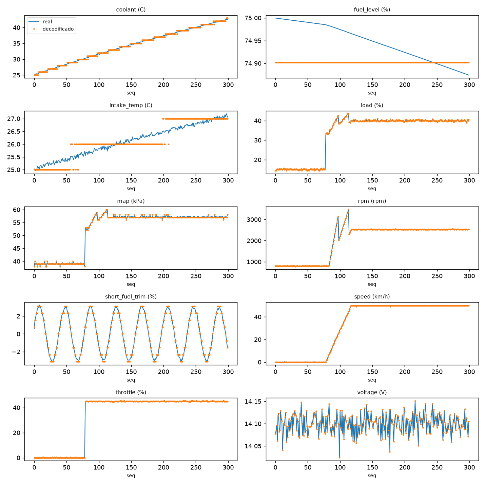
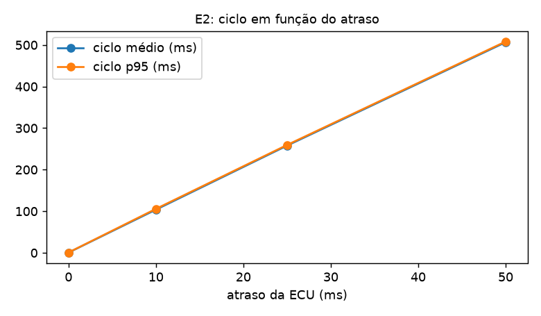
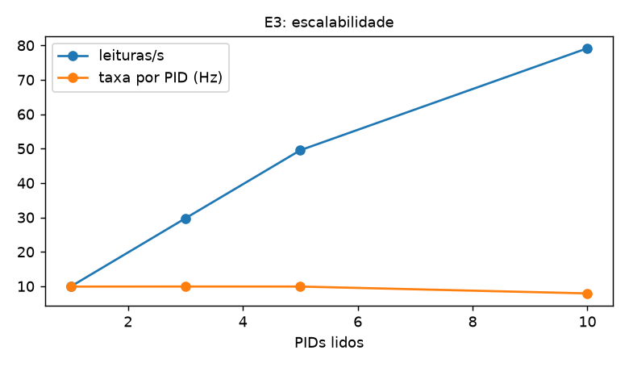
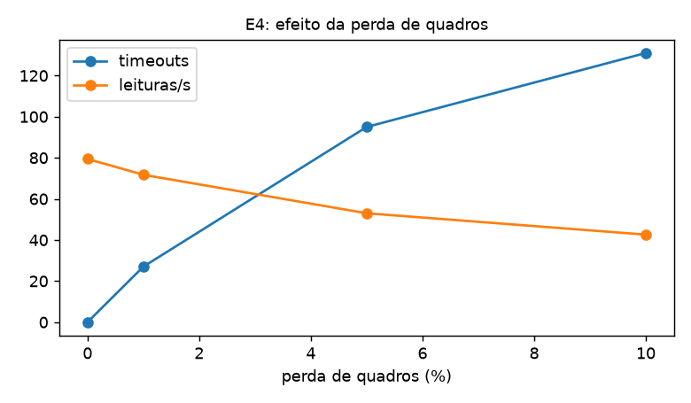
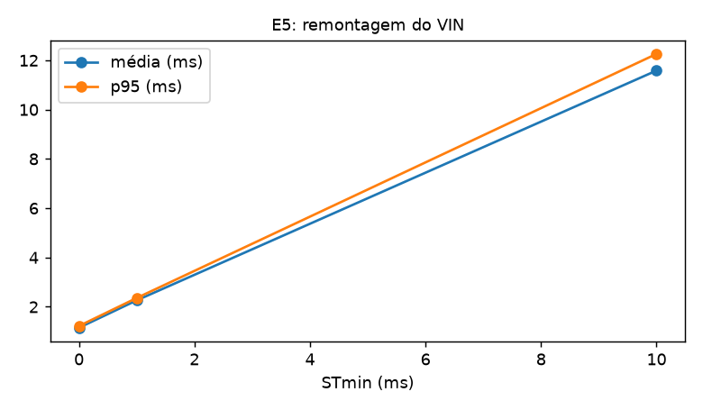
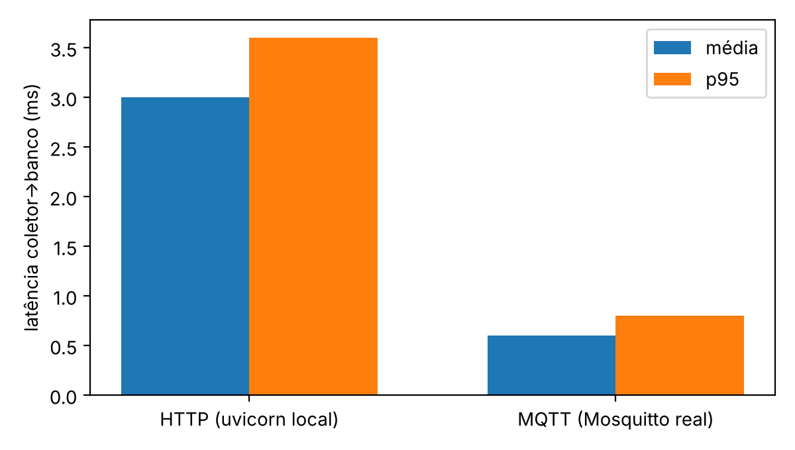

# RESULTADOS E DISCUSSÃO

Este capítulo apresenta os resultados dos testes automatizados, dos sete ensaios de desempenho e da validação com clientes ELM327 de terceiros. Todos os números vêm de uma única máquina (Seção 4.10) e descrevem o simulador e a plataforma que o cerca. Nenhum deles descreve um veículo real. A origem de cada número está no Apêndice A.

## TESTES AUTOMATIZADOS E COBERTURA

A suíte completa tem 405 testes e todos passaram na execução de 24/10/2026 (em Python 3.13.17, ambiente de revisão; a plataforma exige 3.12 ou superior e os ensaios rodaram em 3.12.15), com 2 testes excluídos da execução padrão por exigirem infraestrutura externa (`broker` e `realclient`, descritos na Seção 4.9). A cobertura de linhas, medida com `pytest-cov`, é de 89% no total (2311 linhas executáveis, 254 não cobertas). A Tabela 17 mostra a cobertura dos módulos de protocolo, que é a meta do requisito RNF06 (80% ou mais).

::: {custom-style="LegendaTabela"}
Tabela 17: Cobertura de testes nos módulos de protocolo
:::

| Arquivo | Linhas | Não cobertas | Cobertura |
| --- | --- | --- | --- |
| `protocol/dtc.py` | 19 | 0 | 100% |
| `protocol/errors.py` | 1 | 0 | 100% |
| `protocol/frames.py` | 31 | 0 | 100% |
| `protocol/isotp.py` | 166 | 1 | 99% |
| `protocol/pids.py` | 64 | 0 | 100% |
| `protocol/schemas.py` | 38 | 0 | 100% |
| `protocol/services.py` | 122 | 4 | 97% |

::: {custom-style="Fonte"}
Fonte: saída de `pytest --cov=obd`, em 24/10/2026.
:::

Os módulos de protocolo ficam entre 97% e 100%, bem acima da meta. Nos demais, a cobertura é alta (coletor 93% a 100%, servidor 89% a 100%, simulador 93% a 99%), com duas ressalvas. Os arquivos `runner.py` e `__main__.py` aparecem com 0% porque são exercitados por testes que os executam em subprocesso (inclusive o encerramento limpo por SIGINT e SIGTERM), e a medição de cobertura não acompanha o subprocesso. O módulo `mqtt_common.py` tem 51%, pois parte dele é o adaptador que só roda contra um *broker* real e é coberta apenas pelo teste `broker`, fora da execução padrão.

A suíte também inclui testes de propriedade com `hypothesis`: para cada PID, a decodificação do valor codificado volta ao original dentro de metade da resolução em 1001 valores da faixa, e a remontagem ISO-TP é correta para qualquer comprimento entre 8 e 4095 bytes. Esses testes cobrem o requisito RF06 no nível da função, enquanto o ensaio E1 o cobre no nível do sistema.

## ENSAIO E1: EXATIDÃO E DESEMPENHO BASE

O E1 é o ensaio central: 240 s, 10 PIDs, ECU com atraso aleatório uniforme de 7 a 13 ms (10 ± 3 ms), perfil urbano, sementes 1 e 1, e uma falha P0300 agendada em 100 s. O canal de publicação é HTTP e o intervalo alvo do ciclo é de 100 ms. A Tabela 18 reúne os resultados.

::: {custom-style="LegendaTabela"}
Tabela 18: Resultados do ensaio E1 (240 s, 10 PIDs)
:::

| Medida | Resultado |
| --- | --- |
| Ciclos / leituras | 1907 / 19070 |
| Taxa | 7,94 ciclos/s; 79,4 leituras/s |
| Ciclo (ms) | média 106,1; desvio 5,6; p95 115,6; p99 119,3; máx 124,0 |
| RTT por PID (ms) | média 10,6; desvio 1,8; p95 13,5; p99 13,7; máx 14,1 |
| Latência coletor ao banco (ms) | média 2,9; p95 3,5; p99 3,7; máx 42,2 |
| Perdas, duplicações e timeouts | 0, 0 e 0 |
| Leituras com erro acima de r/2 | 0 de 19070 |
| Detecção da P0300 | 0,79 s após a injeção |

::: {custom-style="Fonte"}
Fonte: docs/ensaios/e1.json.
:::

O ciclo de 10 PIDs custa, em média, 106,1 ms, ou seja, cerca de 10 vezes o RTT médio por PID (10,6 ms). Como o atraso da ECU simulada é de 10 ms em média, o excedente de cerca de 0,6 ms por requisição é o custo de processamento do coletor, do transporte e da ECU somados. Como o ciclo (106 ms) é maior que o intervalo alvo (100 ms), o coletor não espera entre ciclos, e a taxa fica em 7,9 ciclos/s, não em 10.

A latência do coletor ao banco tem média de 2,9 ms e p95 de 3,5 ms. O máximo (42,2 ms) é um valor isolado: o p99 é 3,7 ms, o que indica um único evento ou poucos. Sua causa não foi investigada.

### Exatidão da decodificação

Nenhuma das 19070 leituras teve erro maior que metade da resolução. A Tabela 19 detalha o erro por PID. Os erros máximos ficam muito próximos do limite teórico, e isso é o esperado: o limite é o pior caso do arredondamento, e a distribuição dos valores reais cobre todo o passo de quantização. Se os erros máximos estivessem muito abaixo do limite, seria sinal de que os valores reais caem sempre sobre valores representáveis, ou seja, de um teste pouco exigente. O PID de tensão (0x42) tem resolução de 0,001 V e erro desprezível, porque o valor é transmitido em milivolts; o erro máximo ficou abaixo de 0,0005 V (arredondado para 0,000 na tabela).

::: {custom-style="LegendaTabela"}
Tabela 19: Erro de decodificação por PID no ensaio E1
:::

| PID | Grandeza | Resolução | Leituras | Erro médio | Erro máx. | Limite r/2 |
| --- | --- | --- | --- | --- | --- | --- |
| 0x04 | Carga | 0,392 | 1907 | 0,098 | 0,196 | 0,196 |
| 0x05 | Temp. arrefecimento | 1,000 | 1907 | 0,248 | 0,500 | 0,500 |
| 0x06 | Ajuste de mistura | 0,781 | 1907 | 0,199 | 0,390 | 0,391 |
| 0x0B | MAP | 1,000 | 1907 | 0,231 | 0,500 | 0,500 |
| 0x0C | Rotação | 0,250 | 1907 | 0,063 | 0,125 | 0,125 |
| 0x0D | Velocidade | 1,000 | 1907 | 0,162 | 0,499 | 0,500 |
| 0x0F | Temp. ar de admissão | 1,000 | 1907 | 0,264 | 0,500 | 0,500 |
| 0x11 | Borboleta | 0,392 | 1907 | 0,088 | 0,196 | 0,196 |
| 0x2F | Nível de combustível | 0,392 | 1907 | 0,098 | 0,196 | 0,196 |
| 0x42 | Tensão | 0,001 | 1907 | 0,000 | 0,000 | 0,001 |

::: {custom-style="Fonte"}
Fonte: docs/ensaios/e1.json (campo `por_pid`). Erros e limites na unidade de cada PID.
:::

A Figura 10 mostra, para os 300 primeiros ciclos, o valor real (linha) e o decodificado (pontos) em cada PID. O efeito da quantização é visível em escala fina: na temperatura do ar de admissão, o valor real sobe de forma contínua e o decodificado avança em degraus de 1 °C; no nível de combustível, o valor real varia menos de 0,2 pontos percentuais e o decodificado fica em um único valor, dentro do limite. Na rotação, na velocidade e no ajuste de mistura, os dois acompanham a mesma forma.

{width=15cm}

::: {custom-style="LegendaFigura"}
Figura 10: Valor real e valor decodificado nos 10 PIDs (primeiros 300 ciclos do E1)
:::

::: {custom-style="Fonte"}
Fonte: docs/ensaios/e1_real_vs_decodificado.png, gerado de docs/ensaios/e1_amostra.csv.
:::

### Detecção da falha

A falha P0300 foi agendada em 100 s e o coletor publicou o relatório com o código 0,79 s depois. O coletor consulta o PID `0x01` a cada 2 s e, se o contador mudou, lê o modo 03. Com esse período, o atraso de detecção esperado varia entre perto de zero e 2 s, dependendo de em que ponto do período a falha cai, e 0,79 s está dentro dessa faixa. O requisito RF03 pedia detecção em até 2 ciclos de consulta (4 s): foi atendido.

### Requisitos RNF01 a RNF04

A Tabela 20 compara o medido com o requisito.

::: {custom-style="LegendaTabela"}
Tabela 20: Requisitos não funcionais no ensaio E1
:::

| Requisito | Limite | Medido | Resultado |
| --- | --- | --- | --- |
| RNF01: ciclo de 10 PIDs (p95) | ≤ 150 ms | 115,6 ms | atendido |
| RNF02: latência do coletor ao banco (p95) | ≤ 50 ms | 3,5 ms | atendido |
| RNF03: perdas em 240 s | 0 | 0 | atendido |
| RNF04: identificadores de 11 bits (0x7DF e 0x7E8) e RTT ≤ P2 | ≤ 50 ms | RTT máx. 14,1 ms | atendido; 500 kbit/s não é medido |

::: {custom-style="Fonte"}
Fonte: docs/ensaios/e1.json (campo `rnf`).
:::

O atendimento do RNF04 é parcial por construção. Os identificadores são os da norma e o RTT máximo é bem menor que o P2 de 50 ms, mas a taxa de 500 kbit/s é um parâmetro nominal: o barramento virtual não tem camada física, e portanto não há o que medir.

## ENSAIO E2: SENSIBILIDADE AO ATRASO DA ECU

O E2 repete o cenário com o atraso da ECU fixo em 0, 10, 25 e 50 ms, 30 s cada (Tabela 21 e Figura 11).

::: {custom-style="LegendaTabela"}
Tabela 21: Resultados do ensaio E2
:::

| Atraso | Ciclo médio (ms) | Ciclo p95 (ms) | Ciclos/s | Leituras/s | RNF01 |
| --- | --- | --- | --- | --- | --- |
| 0 ms | 0,5 | 0,7 | 9,9 | 99,4 | atendido |
| 10 ms | 103,8 | 105,8 | 8,1 | 81,1 | atendido |
| 25 ms | 257,8 | 259,5 | 3,5 | 35,4 | não atendido |
| 50 ms | 506,4 | 508,2 | 1,8 | 18,5 | não atendido |

::: {custom-style="Fonte"}
Fonte: docs/ensaios/e2.json; docs/ensaios.md.
:::

{width=11cm}

::: {custom-style="LegendaFigura"}
Figura 11: Tempo de ciclo em função do atraso da ECU (E2)
:::

::: {custom-style="Fonte"}
Fonte: docs/ensaios/e2_sensibilidade.png.
:::

O ciclo cresce de forma linear, em cerca de 10 vezes o atraso, o que reflete a natureza sequencial do coletor: cada um dos 10 PIDs é requisitado depois que o anterior respondeu. Com atraso de 0 ms, o ciclo é menor que 1 ms e a taxa fica em 10 ciclos/s, limitada pelo intervalo alvo de 100 ms e não pelo custo de processamento. O limite do RNF01 (150 ms) é ultrapassado a partir de aproximadamente 14 ms de atraso por PID, e com 25 ms ou mais ele não é atendido. Isso não é um defeito da plataforma, e sim uma propriedade do modo de requisição serial: o RNF01 foi definido para uma ECU em 10 ms, e o E2 mostra até onde essa premissa se sustenta.

O ensaio com 50 ms também ultrapassa o RTT máximo de 50 ms do RNF04 (RTT máximo de 51,2 ms), o que é coerente: a ECU responde com esse atraso fixo, mais o processamento do coletor. Quando isso acontece, uma ECU real excederia o P2, e uma ferramenta que respeitasse a norma trataria o PID como sem resposta. O coletor desta plataforma usa um *timeout* de 100 ms, mais folgado, e por isso ainda lê normalmente.

Uma estratégia para recuperar o requisito com ECUs mais lentas seria requisitar mais de um PID por mensagem (a SAE J1979 prevê, em CAN, mais de um PID por requisição do modo 01) ou paralelizar as requisições; nenhuma das duas está implementada, e ficam como melhoria futura.

## ENSAIO E3: NÚMERO DE PIDS

O E3 varia o número de PIDs por ciclo (1, 3, 5 e 10), com a ECU em 10 ± 3 ms e 20 s por execução (Tabela 22 e Figura 12).

::: {custom-style="LegendaTabela"}
Tabela 22: Resultados do ensaio E3
:::

| PIDs | Ciclo médio (ms) | Ciclo p95 (ms) | Taxa por PID (Hz) | Leituras/s |
| --- | --- | --- | --- | --- |
| 1 | 10,6 | 13,6 | 9,9 | 9,9 |
| 3 | 32,0 | 37,3 | 9,9 | 29,7 |
| 5 | 53,5 | 59,7 | 9,9 | 49,5 |
| 10 | 106,6 | 116,9 | 7,9 | 79,2 |

::: {custom-style="Fonte"}
Fonte: docs/ensaios/e3.json; docs/ensaios.md.
:::

{width=11cm}

::: {custom-style="LegendaFigura"}
Figura 12: Taxa por PID e leituras por segundo em função do número de PIDs (E3)
:::

::: {custom-style="Fonte"}
Fonte: docs/ensaios/e3_escalabilidade.png.
:::

O ciclo cresce linearmente com o número de PIDs, em cerca de 10,6 ms por PID, igual ao RTT médio (10,6 ms em todas as execuções, o que mostra que o custo marginal de um PID extra é exatamente o de uma requisição). Até 5 PIDs, o ciclo cabe dentro do intervalo alvo de 100 ms e cada PID é lido a 9,9 Hz. Com 10 PIDs, o ciclo ultrapassa o intervalo e a taxa por PID cai para 7,9 Hz. A vazão total, em leituras por segundo, continua crescendo (de 9,9 a 79,2), mas a taxa de atualização de cada PID deixa de ser a desejada. O plano de leitura com PIDs rápidos e lentos, descrito na Seção 4.7, existe justamente para isso: ele reserva o ciclo curto para as grandezas que variam depressa (rotação, MAP, borboleta, velocidade) e lê as demais a cada 5 ciclos.

## ENSAIO E4: PERDA DE QUADROS

O E4 injeta perda de 0, 1, 5 e 10% das requisições recebidas pela ECU, com 10 PIDs e 30 s por execução (Tabela 23 e Figura 13). Para o coletor, uma resposta perdida é um *timeout* de 100 ms.

::: {custom-style="LegendaTabela"}
Tabela 23: Resultados do ensaio E4
:::

| Perda | Ciclos | Timeouts | Timeouts por ciclo | Ciclo médio (ms) | Leituras/s | Máx. de ciclos seguidos sem leitura de um PID |
| --- | --- | --- | --- | --- | --- | --- |
| 0% | 239 | 0 | 0,00 | 106,3 | 79,4 | 0 |
| 1% | 218 | 27 | 0,12 | 117,3 | 71,7 | 1 |
| 5% | 169 | 95 | 0,56 | 157,0 | 53,0 | 2 |
| 10% | 141 | 131 | 0,93 | 190,5 | 42,6 | 2 |

::: {custom-style="Fonte"}
Fonte: docs/ensaios/e4.json; docs/ensaios.md.
:::

{width=11cm}

::: {custom-style="LegendaFigura"}
Figura 13: Timeouts e leituras por segundo em função da perda de quadros (E4)
:::

::: {custom-style="Fonte"}
Fonte: docs/ensaios/e4_perdas.png.
:::

O custo da perda é, em primeira aproximação, o do *timeout*: cada resposta perdida acrescenta cerca de 100 ms ao ciclo. Com 1% de perda, há em média 0,12 timeout por ciclo e o ciclo médio sobe 11 ms (de 106,3 para 117,3), compatível com 0,12 × 100 ms. Com 5%, são 0,56 timeouts por ciclo e o ciclo sobe 51 ms, próximo dos 56 ms que o mesmo cálculo daria. Com 10%, o ciclo sobe 84 ms, um pouco menos que os 93 ms que o mesmo raciocínio daria, o que sugere que algum efeito adicional (como o recuo progressivo, que age após três falhas seguidas) interfere; essa diferença não foi investigada.

O ponto mais importante é a recuperação. Em nenhuma execução houve mais de 2 ciclos seguidos sem leitura de um mesmo PID, o servidor nunca perdeu uma amostra (publicadas e recebidas são iguais em todos os casos) e o coletor sempre seguiu para o PID seguinte depois do *timeout*. A perda reduz a vazão (de 79,4 para 42,6 leituras por segundo com 10%), mas não corrompe nem interrompe a cadeia. Esse é o comportamento esperado pelo requisito RF11.

## ENSAIO E5: REMONTAGEM ISO-TP

O E5 mede o tempo para ler o VIN (modo 09, PID 02), que exige um primeiro quadro, um controle de fluxo e dois quadros consecutivos, com STmin de 0, 1 e 10 ms, em 100 repetições cada (Tabela 24 e Figura 14).

::: {custom-style="LegendaTabela"}
Tabela 24: Tempo de remontagem do VIN (E5, 100 repetições)
:::

| STmin | Média (ms) | Desvio | Mediana | p95 | p99 | Máx |
| --- | --- | --- | --- | --- | --- | --- |
| 0 ms | 1,15 | 0,04 | 1,14 | 1,22 | 1,23 | 1,24 |
| 1 ms | 2,26 | 0,06 | 2,25 | 2,36 | 2,45 | 2,47 |
| 10 ms | 11,58 | 0,45 | 11,35 | 12,26 | 12,29 | 12,31 |

::: {custom-style="Fonte"}
Fonte: docs/ensaios/e5.json; docs/ensaios.md.
:::

{width=11cm}

::: {custom-style="LegendaFigura"}
Figura 14: Tempo de remontagem do VIN em função do STmin (E5)
:::

::: {custom-style="Fonte"}
Fonte: docs/ensaios/e5_stmin.png.
:::

O tempo de remontagem é aproximadamente o custo base de 1,15 ms somado ao STmin: 2,26 ms com 1 ms e 11,58 ms com 10 ms, o que é compatível com a espera de um intervalo STmin entre os dois quadros consecutivos. Em todas as 300 repetições, o VIN remontado estava correto. Com STmin de 10 ms, o desvio padrão é maior (0,45 ms), como esperado de uma espera por temporizador. Para o uso do coletor, a leitura do VIN ocorre uma vez, e mesmo com STmin de 10 ms o custo (cerca de 12 ms) cabe dentro do P2 de 50 ms.

## VALIDAÇÃO COM CLIENTES ELM327 DE TERCEIROS

A camada ELM327 foi validada em três níveis crescentes de independência: um cliente de soquete cru escrito pelos autores (E6), a biblioteca python-OBD e o aplicativo OBD Auto Doctor.

### E6: cliente de soquete cru

O E6 envia 19 comandos ao servidor TCP e confere cada resposta com uma expressão regular: `ATZ`, `ATE0`, `ATL0`, `ATS1`, `ATH0`, `ATSP0`, `ATDP`, `ATRV`, `0100`, `0120`, `010C`, `010D`, `0105`, `0111`, `0101`, `03`, `0902`, `01FF` e `XYZ`. As 19 respostas vieram no formato esperado. O E6 comprova que o servidor cumpre a especificação que os próprios autores escreveram, mas não que essa especificação reproduz o que um cliente real espera. Esse é o papel dos dois níveis seguintes.

### python-OBD

A biblioteca python-OBD, na versão 0.7.3, foi apontada para o servidor (`socket://127.0.0.1:<porta>`) pelo teste de integração `test_elm327_python_obd.py`, que instala a biblioteca em um ambiente virtual temporário. A primeira execução, antes das correções da tarefa 16, conectou e reconheceu o protocolo (`ISO 15765-4 (CAN 11/500)`), mas não leu nenhum PID. A análise da troca de comandos mostrou três causas:

1. o servidor ignorava `ATH1`, e a biblioteca descartava os quadros sem cabeçalho ("dropping frame for being odd");
2. os comandos `ATDPN` e `ATTP6` recebiam `?`, quando deveriam responder `A6` e `OK`;
3. os modos `0900` e `0600` recebiam `7F ...`, quando um adaptador real responderia a máscara de PIDs do modo 09 e `NO DATA`, respectivamente.

Depois da correção, a biblioteca reporta "Car Connected", o protocolo correto, e lê rotação, velocidade, temperatura do líquido de arrefecimento, carga, borboleta e nível de combustível, todos dentro da resolução do PID. Com a rotação sobreposta em 3000 rpm no simulador, a biblioteca lê 3000. Com o P0300 injetado, `GET_DTC` devolve P0300, e sem falhas devolve lista vazia.

O resultado ilustra bem o valor de um cliente independente. A suíte de testes passava, porque era escrita contra a própria interpretação dos autores sobre o dialeto. Só um terceiro mostrou que a interpretação estava incompleta.

### OBD Auto Doctor

O aplicativo OBD Auto Doctor, em versão de avaliação para Windows, foi configurado com conexão Wi-Fi apontando para o computador que executa o simulador, na porta 35000, e protocolo automático. Na primeira tentativa, exibiu "Failed to initialize the adapter". A causa foi o dialeto ainda incompleto: o aplicativo enviava `ATAT1`, `ATST62` e `ATDPN` (recebendo `?`) e consultava `ATI`, que também não era reconhecido. Com as correções da tarefa 16 e o tratamento de `ATI` e `ATWS` (que passaram a devolver a versão do dispositivo), a conexão foi estabelecida.

Com o simulador em execução e a rotação sobreposta em 3000 rpm, os valores exibidos pelo aplicativo coincidiram com os do painel de controle do simulador. A tela de códigos de falha listou P0300 e P0301, injetados pelo painel, e a limpeza pelo aplicativo (modo 04) zerou a lista. Essas observações foram feitas manualmente pelos autores, em uma única sessão; não há medida estatística associada, e o aplicativo, por ser de terceiros e de versão de avaliação, pode se comportar de forma diferente em outras versões. Os demais aplicativos citados no README (Car Scanner e Torque) não foram validados.

Para facilitar o diagnóstico de futuros clientes, o servidor registra cada comando recebido e a resposta enviada quando a variável de ambiente `OBD_ELM327_LOG=1` está ativa. Foi o que permitiu identificar `ATI` como a causa da falha do OBD Auto Doctor.

## ENSAIO E7: HTTP CONTRA MQTT

O E7 compara os dois canais de publicação, 60 s cada, com 10 PIDs, atraso da ECU de 7 a 13 ms e as mesmas sementes. A execução com MQTT usou um Mosquitto real (imagem `eclipse-mosquitto:2`), em contêiner no mesmo computador, e o simulador e o coletor em outro contêiner, pela rede interna do Docker. Os dois canais rodaram em sequência na mesma máquina (Tabela 25 e Figura 15).

::: {custom-style="LegendaTabela"}
Tabela 25: Resultados do ensaio E7 (60 s por canal, Mosquitto real)
:::

| Canal | Ciclos | Latência média (ms) | p95 (ms) | Máx (ms) | Perdas | Ciclos/s |
| --- | --- | --- | --- | --- | --- | --- |
| HTTP (Uvicorn local) | 463 | 3,0 | 3,6 | 43,5 | 0 | 7,7 |
| MQTT (Mosquitto real) | 558 | 0,6 | 0,8 | 13,4 | 0 | 9,3 |

::: {custom-style="Fonte"}
Fonte: docs/ensaios/e7_mosquitto.json; docs/ensaios.md.
:::

{width=10cm}

::: {custom-style="LegendaFigura"}
Figura 15: Latência do coletor ao banco por canal de publicação (E7, Mosquitto real)
:::

::: {custom-style="Fonte"}
Fonte: elaborada pelos autores a partir de docs/ensaios/e7_mosquitto.json (médias e p95 da Tabela 25).
:::

Os dois canais entregaram todas as amostras: perdas, duplicações e *timeouts* foram zero, e o erro de decodificação acima de meia resolução também. O MQTT teve latência média cerca de cinco vezes menor (0,6 ms contra 3,0 ms) e máximo cerca de três vezes menor. O tempo de ciclo do coletor e o RTT da ECU foram praticamente iguais (ciclo p95 de 115,8 ms no HTTP e 115,7 ms no MQTT; RTT p95 de 13,5 ms nos dois), pois dependem da ECU simulada e não do canal.

A diferença em ciclos por segundo (7,7 contra 9,3) vem do tempo gasto publicando: no HTTP, o coletor espera a resposta de cada envio antes de seguir; no MQTT com QoS 0, ele entrega a mensagem ao cliente e continua. Essa explicação é coerente com o comportamento dos protocolos, mas não foi verificada por uma medição específica.

As condições limitam a interpretação. Publicador e *broker* estavam no mesmo computador, por uma rede interna do Docker, e o servidor HTTP também era local. Os números descrevem o custo de cada canal nesse arranjo e não representam um enlace real entre máquinas diferentes, em que a latência de rede e a perda de pacotes alterariam as duas curvas. Além disso, a execução MQTT usou QoS 0, o que explica parte da vantagem (não há confirmação de recebimento) e também o risco: em caso de queda do *broker*, uma mensagem em trânsito pode se perder, e o servidor a vê como lacuna do número de sequência.

Um arquivo anterior do E7 (`docs/ensaios/e7.json`) foi gerado sem *broker* real, com um intermediário em memória usado nos testes. Nele, a latência MQTT média é 0,2 ms, que exclui rede e *broker*. Esse arquivo é mantido apenas como exemplo do formato, e os números deste trabalho são os do Mosquitto real.

## REPRODUTIBILIDADE E AMEAÇAS À VALIDADE

**Reprodutibilidade determinística.** Com as mesmas sementes e o mesmo perfil, a sequência de valores físicos do simulador é idêntica, e portanto os valores reais, os valores decodificados e os erros de decodificação coincidem entre execuções. Esse resultado é consequência do projeto (sementes explícitas, relógio injetável e passos fixos de 10 ms) e é verificado pelos testes do modelo de veículo.

**Reprodutibilidade de tempos.** Ciclo, RTT e latência dependem de relógio real, do sistema operacional e da CPU, e não são reproduzidos bit a bit. Os números das seções anteriores vêm de uma execução de cada ensaio em um computador (contêiner Linux sobre WSL2, 32 núcleos lógicos, Python 3.12.15). Para ter uma noção da variação entre execuções, os autores repetiram os ensaios E1, E2 e E3 em um novo contêiner Docker (imagem de desenvolvimento do projeto, dependências instaladas no início da execução), no mesmo computador, com os mesmos parâmetros e sementes. A Tabela 26 compara as duas execuções.

::: {custom-style="LegendaTabela"}
Tabela 26: Execução original e repetição em contêiner isolado (E1 a E3, mesma máquina)
:::

| Medida | Original | Repetição |
| --- | --- | --- |
| E1: ciclo p95 (ms) | 115,6 | 115,8 |
| E1: RTT p95 (ms) | 13,5 | 13,5 |
| E1: latência coletor ao banco p95 (ms) | 3,5 | 3,8 |
| E1: detecção da P0300 (s) | 0,79 | 1,71 |
| E2: ciclo p95 com atraso de 0 ms (ms) | 0,7 | 0,8 |
| E2: ciclo p95 com atraso de 10 ms (ms) | 105,8 | 104,0 |
| E2: ciclo p95 com atraso de 25 ms (ms) | 259,5 | 259,3 |
| E2: ciclo p95 com atraso de 50 ms (ms) | 508,2 | 508,6 |
| E3: ciclo p95 com 1 PID (ms) | 13,6 | 13,7 |
| E3: ciclo p95 com 3 PIDs (ms) | 37,3 | 37,3 |
| E3: ciclo p95 com 5 PIDs (ms) | 59,7 | 59,8 |
| E3: ciclo p95 com 10 PIDs (ms) | 116,9 | 116,7 |
| Perdas, duplicações, timeouts e leituras com erro acima de r/2 (todos os casos) | 0 | 0 |

::: {custom-style="Fonte"}
Fonte: tabelas anteriores deste capítulo e saída de terminal da repetição, feita pelos autores em 24/10/2026 (comando do Apêndice B; arquivos em `runs/repeticao/`, não versionados).
:::

Os tempos de ciclo, RTT e latência ficaram muito próximos (diferenças de até 0,3 ms na latência e de até 1,8 ms no ciclo de 10 ms de atraso), e todos os requisitos continuaram atendidos, com erro de decodificação, perdas, duplicações e *timeouts* iguais a zero. A única medida que mudou de modo visível foi o tempo de detecção da P0300, de 0,79 s para 1,71 s. Isso é esperado: o instante em que a falha é agendada é o mesmo, mas o relógio de parede e a fase do período de 2 s da consulta ao PID `0x01` variam de uma execução para outra, e o atraso de detecção cai em qualquer ponto entre perto de zero e 2 s. Ambos os valores estão dentro desse intervalo. A repetição não é independente (ver a Seção 4.10), e uma segunda máquina, prevista no requisito RNF05, continua pendente (Apêndice B). Cada ensaio, nas duas execuções, é uma única amostra de tempo, de modo que não foi calculada uma variação estatística entre execuções.

**Ameaças à validade.** As principais são: (i) a ECU simulada é um modelo, e o que ela responde é o que os autores entenderam da norma; a validação com python-OBD e OBD Auto Doctor reduz esse risco, mas não o elimina; (ii) o barramento CAN não é reproduzido fisicamente, e os ensaios usam o laço local, sem custo de barramento; (iii) os tempos de relógio real foram medidos com outras tarefas rodando no mesmo computador, sem isolamento de CPU; (iv) o atraso da ECU é uma variável aleatória simples (uniforme), enquanto uma ECU real tem distribuição própria; (v) o modelo de veículo é ilustrativo, e as variáveis são coerentes entre si, mas não calibradas contra dados reais.

## ATENDIMENTO AOS REQUISITOS

A Tabela 27 resume a situação de cada requisito e a evidência.

::: {custom-style="LegendaTabela"}
Tabela 27: Atendimento aos requisitos
:::

| Requisito | Situação | Evidência |
| --- | --- | --- |
| RF01 a RF05 (protocolo, descoberta, DTCs, freeze frame, ISO-TP) | Atendidos | Testes unitários, de propriedade e de integração; E5 (VIN) |
| RF06 (decodificação com erro ≤ r/2) | Atendido | E1: 0 de 19070 leituras acima do limite |
| RF07 (persistência sem perda nem duplicação) | Atendido | E1 a E7: perdas e duplicações iguais a 0 |
| RF08 (API e WebSocket) | Atendido | Testes de integração e de ponta a ponta; dashboard |
| RF09 (painel de controle) | Atendido | Testes da API de controle; Figuras 7 e 8 |
| RF10 (camada ELM327) | Atendido para python-OBD e OBD Auto Doctor | Seção 5.7 |
| RF11 (falhas de comunicação) | Atendido | E4; testes de recuo e de ECU muda |
| RF12 (transporte plugável) | Atendido para `loopback`, `can_virtual` e `elm327_tcp` | Testes de integração dos três transportes |
| RNF01 a RNF03 | Atendidos | Tabela 20 |
| RNF04 (conformidade ISO 15765-4) | Parcial | Identificadores e P2 verificados; 500 kbit/s não medido |
| RNF05 (reprodutibilidade) | Parcial | Determinismo verificado; segunda máquina pendente |
| RNF06 (cobertura ≥ 80% no protocolo) | Atendido | 97% a 100% (Tabela 17) |
| RNF07 (instalação com um comando) | Atendido | `make run` e `docker compose up app` |
| RNF08 (somente leitura, sem exposição externa) | Atendido | Escuta em `127.0.0.1` por padrão; modo 04 só no simulador |

::: {custom-style="Fonte"}
Fonte: elaborada pelos autores.
:::

## DISCUSSÃO

Quatro observações emergem do conjunto de resultados.

**A plataforma cumpre o que prometeu como ambiente de validação.** Os requisitos de exatidão, latência e perda foram atendidos com folga (ciclo p95 de 115,6 ms contra 150 ms; latência p95 de 3,5 ms contra 50 ms; nenhuma perda), e a capacidade de medir o erro contra um valor real conhecido é o que distingue este trabalho de um simples leitor OBD-II. A margem, porém, não deve ser lida como desempenho em um veículo: o ambiente tem RTT de 10 ms por escolha do modelo e sem a temporização do barramento físico.

**O gargalo é o modo de requisição serial, não o processamento.** O custo de processamento é de cerca de 0,6 ms por requisição (E1, coletor, transporte e ECU somados), e quase todo o ciclo é espera pela ECU. Isso explica a linearidade do E2 e do E3, e aponta onde otimizar: requisitar vários PIDs por mensagem, ou reduzir o número de PIDs lidos a cada ciclo por meio do plano rápido e lento.

**O comportamento sob falha é robusto, mas tem preço previsível.** O E4 mostra que cada resposta perdida custa um *timeout* e que a vazão cai de forma quase proporcional, sem perda no servidor e sem travar o coletor. Para uma aplicação que precise de taxa mínima garantida, o *timeout* de 100 ms poderia ser reduzido (o P2 da norma é 50 ms), com o risco de tratar como perdidas respostas apenas lentas.

**Validação por terceiros revela o que testes próprios não revelam.** O ciclo de correções da camada ELM327 (Seção 5.7) é o exemplo mais claro: a suíte estava toda verde, e dois clientes independentes falharam na primeira tentativa. O ganho de ter um transporte intercambiável e uma camada de compatibilidade é justamente poder exercitar o software contra o mundo externo antes de ligar qualquer hardware.
